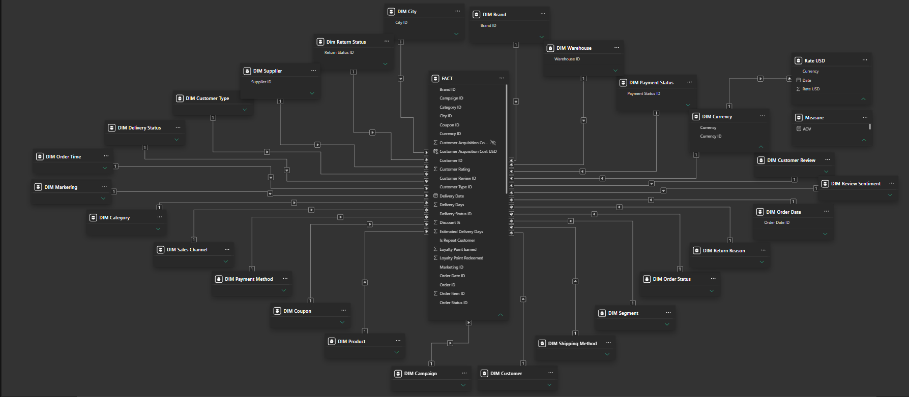
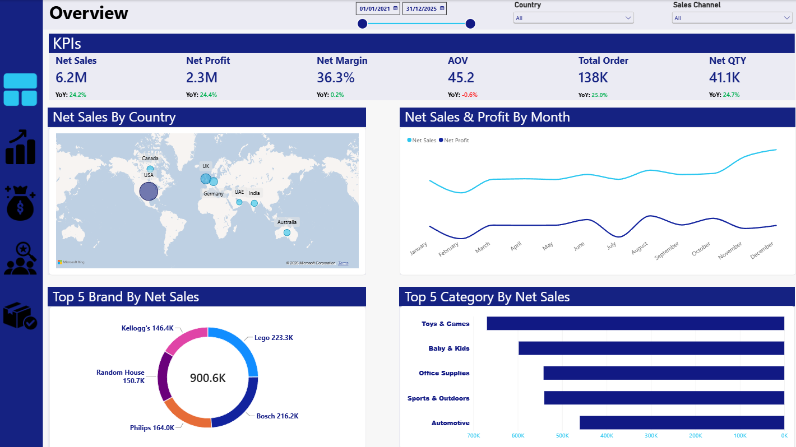
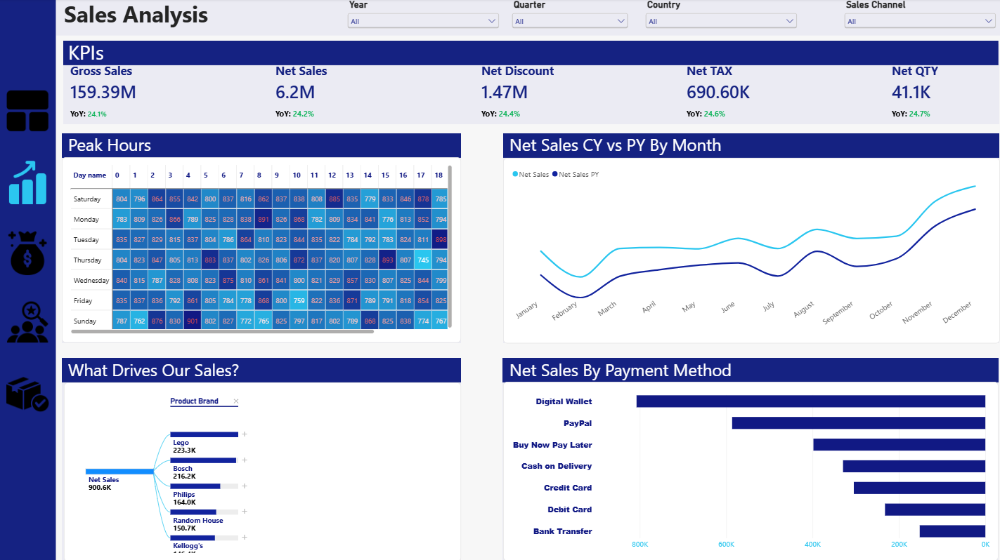
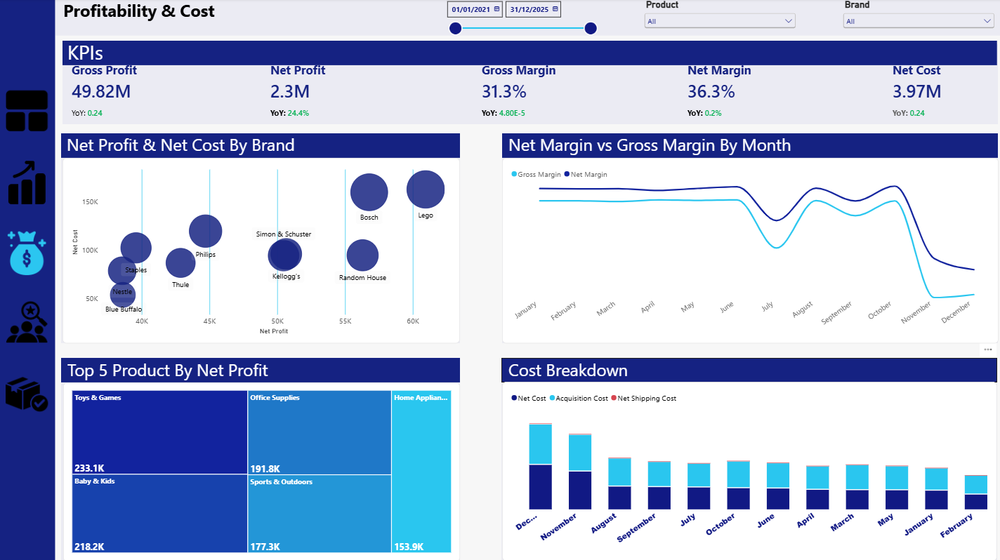
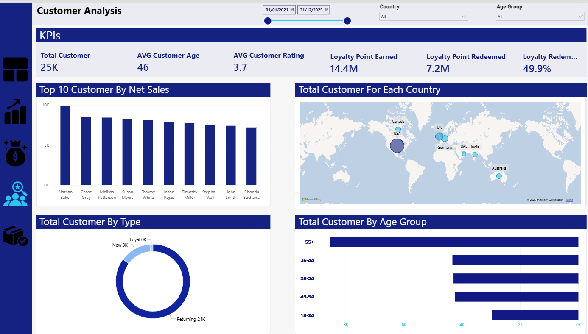
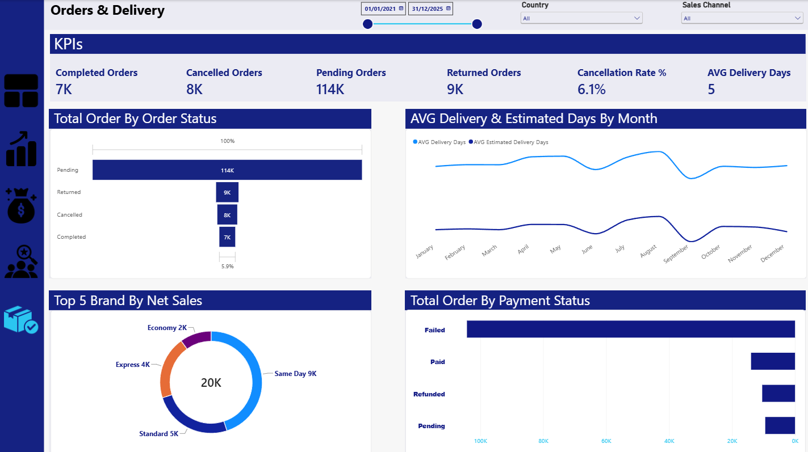

# E-Commerce Data Analysis | SQL Server & Power BI

## 📌 Project Overview

This project focuses on analyzing e-commerce business performance by transforming raw data into meaningful business insights using SQL Server and Power BI.

The project covers an end-to-end data analytics workflow, starting with database creation and data quality assessment, followed by data cleaning and transformation using SQL, data modeling in Power BI, and finally developing an interactive dashboard to analyze sales, profitability, customer behavior, and order delivery performance.

## 🛠️ Tools & Technologies

- **SQL Server:** Database creation, data exploration, data cleaning, transformation, and data integration.
- **Power BI:** Data modeling, relationship management, and interactive dashboard development.
- **DAX:** Creating analytical measures and calculating business KPIs.

## 📊 Project Workflow

### 1. Database Creation & Data Import

- Created a SQL Server database for the e-commerce project.
- Imported raw CSV datasets into separate database tables.
- Organized the data into four main tables:
  - Customer
  - Product
  - Order Item
  - Ecommerce Transaction

### 2. Data Quality Assessment & Cleaning (SQL Server)

Performed data quality checks and cleaning operations on each table to ensure data accuracy and consistency.

#### Customer Table

- Created a Primary Key using Customer ID.
- Checked Customer Name and Customer Age for NULL values.
- Investigated potential outliers in Customer Age.
- Validated Gender values.
- Renamed columns for better readability.
- Created a separate analysis table containing the required business columns.

#### Product Table

- Checked the overall data quality.
- Verified that the data was consistent and suitable for analysis.
- Created a separate analysis table containing the required columns.

#### Order Item Table

- Identified the table as a Bridge Table because the relationship between Orders and Products is many-to-many.
- Attempted to create a Composite Primary Key using Order ID and Product ID.
- Discovered duplicate combinations caused by multiple records for the same order and product.
- Created a new unique identifier (OrderItemID) and assigned it as the Primary Key.
- Checked Quantity, Unit Price, Unit Cost, Discount Percentage, and Shipping Cost for NULL values and outliers.
- Created a separate analysis table.

#### Ecommerce Transaction Table

Performed extensive data quality checks across the transaction table.

- Validated Order ID uniqueness.
- Checked Order Date, Order Time, Order Status, Sales Channel, Customer ID, and Customer Type.
- Validated Payment Method, Payment Status, Currency, Shipping Method, and Warehouse.
- Investigated missing Delivery Dates and Actual Delivery Dates.
  - Identified that missing delivery dates were associated with cancelled orders.
  - Preserved these NULL values because they represent valid business conditions.
- Checked Delivery Status.
- Investigated missing Return Status and Return Reason values.
  - Identified that missing values were associated with cancelled orders.
- Analyzed Customer Rating and checked for outliers.
- Investigated missing Review Sentiment values and classified customer feedback based on rating thresholds:
  - Ratings above 3.5: Positive.
  - Ratings above 2.5 and up to 3.5: Neutral.
  - Ratings of 2.5 or below: Negative.
- Investigated missing Customer Review values and used the most frequent review value within the Positive sentiment group for imputation.
- Validated Marketing Channel.
- Replaced missing Campaign Name values with 'Default Campaign'.
- Replaced missing Coupon Code values with 'No Code'.
- Checked Loyalty Points Earned and Loyalty Points Redeemed for potential outliers.
- Created a separate analysis table containing the required columns.

### 3. Data Integration & Preparation

- Combined the required data from the analysis tables using SQL JOIN operations.
- Created an integrated dataset to simplify the analytical process.
- Prepared the data for Power BI data modeling.

### 4. Data Modeling (Power BI)

Designed a structured data model using a Star Schema approach.

- Created Dimension Tables.
- Prepared the Fact Table.
- Established relationships between Fact and Dimension Tables.
- Configured relationships through the Model View.
- Organized the data model to support efficient analytical queries and reporting.

#### Data Model




### 5. Dashboard Development (Power BI)

Developed an interactive Power BI dashboard consisting of five analytical pages.

#### Page 1: Overview

- Provides a high-level overview of overall business performance.
- Presents key business metrics and performance indicators.

#### Page 2: Sales Analysis

- Analyzes sales performance.
- Explores sales trends and business performance across different dimensions.

#### Page 3: Profitability & Cost Analysis

- Evaluates business profitability.
- Analyzes revenue, costs, and profit performance.

#### Page 4: Customer Analysis

- Examines customer behavior and characteristics.
- Provides insights into customer-related performance.

#### Page 5: Order & Delivery Analysis

- Analyzes order performance and statuses.
- Evaluates delivery performance and fulfillment operations.

## 📸 Dashboard Screenshots

### 1. Overview



### 2. Sales Analysis



### 3. Profitability & Cost Analysis



### 4. Customer Analysis



### 5. Order & Delivery Analysis



## 🎯 Key Skills Demonstrated

- Relational Database Design
- SQL Data Exploration
- Data Quality Assessment
- Data Cleaning & Transformation
- Handling Missing Values
- Outlier Detection
- Primary Key Design
- SQL JOIN Operations
- Data Integration
- Star Schema Data Modeling
- Fact & Dimension Tables
- Power BI
- DAX
- Business Intelligence & Data Visualization
- Analytical Thinking & Business Understanding

## 📁 Project Structure

```text
E-Commerce-Data-Analysis/
│
├── README.md
│
├── SQL-Scripts/
│   ├── Customer.sql
│   ├── Product.sql
│   ├── Order Item.sql
│   ├── Ecommerce.sql
│   └── Merge & Schema.sql
│
├── Data-Modeling/
│   ├── Data-Model-1.png
│   └── Data-Model-2.png
│
└── Dashboard/
    ├── Overview.png
    ├── Sales-Analysis.png
    ├── Profitability-Cost.png
    ├── Customer-Analysis.png
    └── Order-Delivery.png
```

## 🏁 Conclusion

This project demonstrates an end-to-end data analytics workflow, combining SQL Server and Power BI to transform raw e-commerce data into a structured analytical model and interactive business intelligence dashboard.

The main objective was to ensure data quality, maintain data consistency, build an effective data model, and provide meaningful insights into different aspects of e-commerce business performance.
